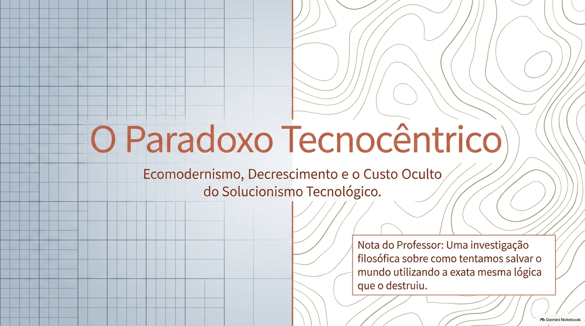
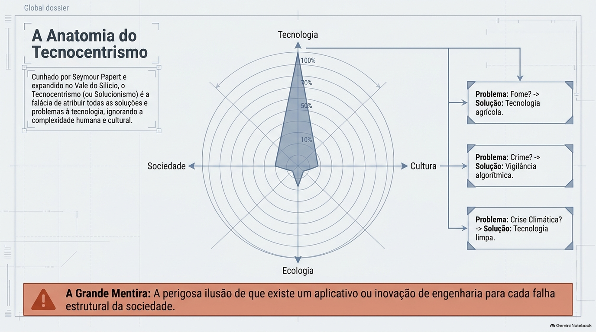
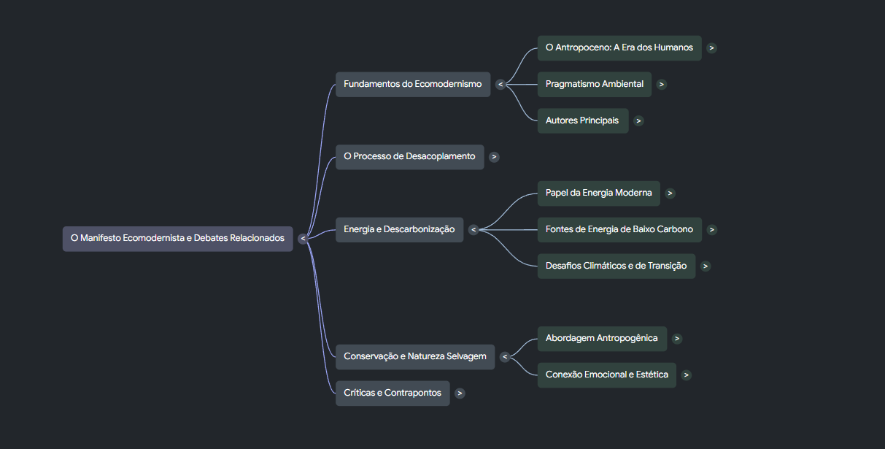
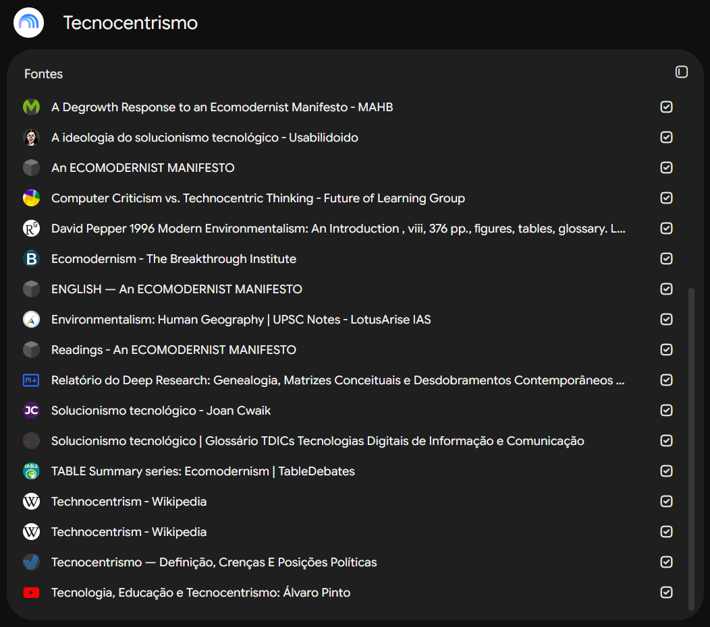
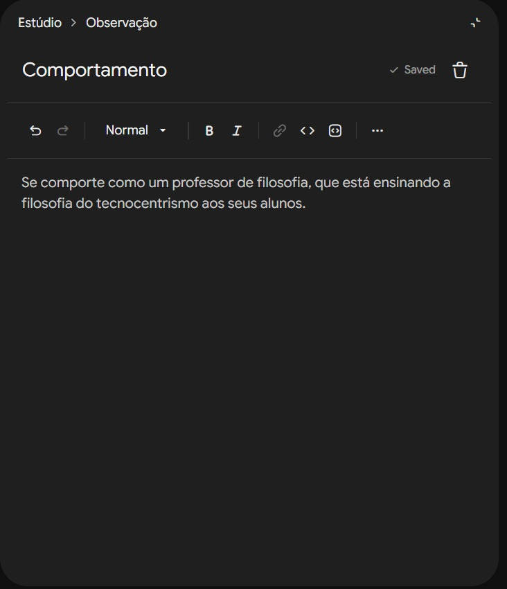
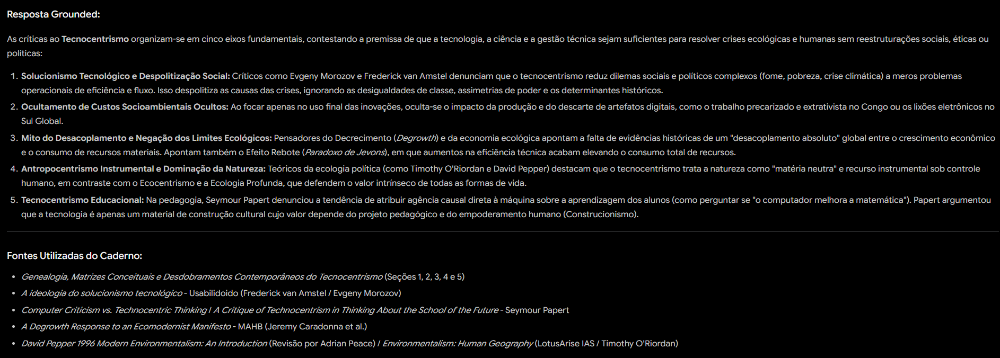
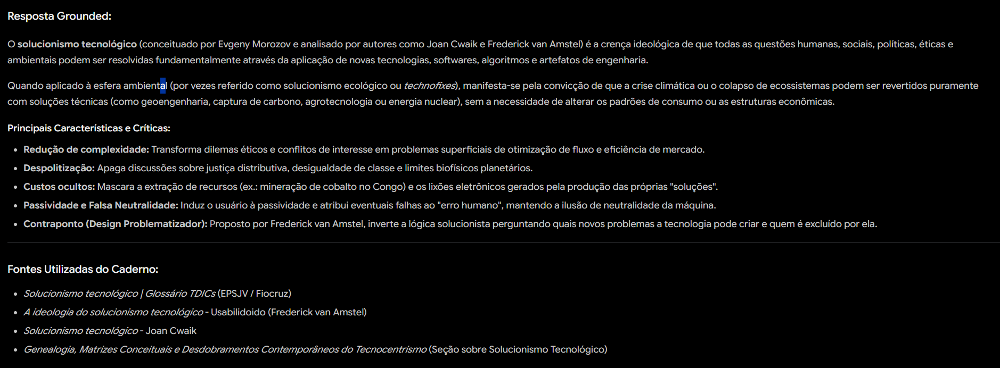
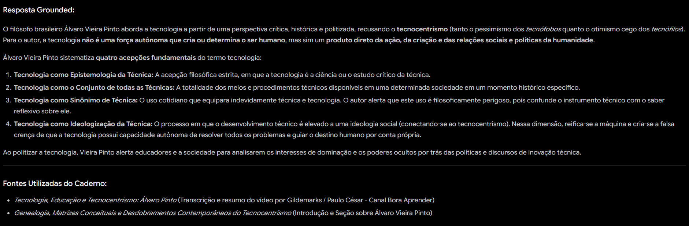
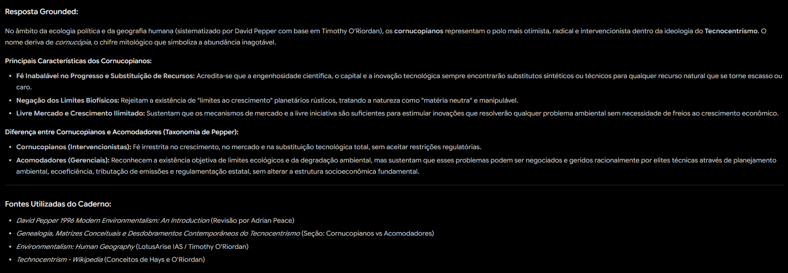
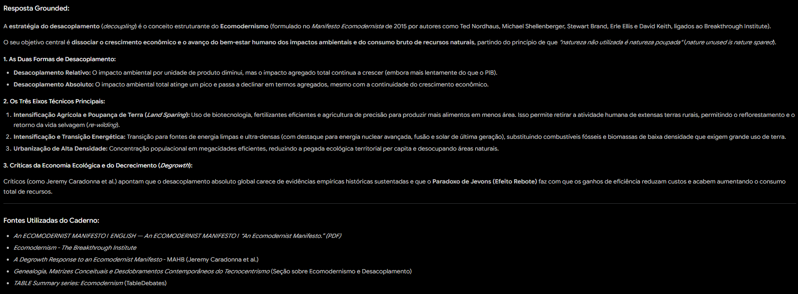

# Notebook Gemini Tecnocentrismo

   

Notebook criado para entrega de projeto no bootcamp da DIO.

O tema escolhido foi a ideologia do tecnocentrismo, e o notebook foi criado com o objetivo de aprimorar meus estudos sobre essa ideologia.

# Fontes selecionadas

Inicialmente foram adicionadas 3 fontes manualmente por mim ao notebook, antes de adicioná-las, consumi parte do conteúdo delas e acreditei que continham informações úteis para o estudo do tecnocentrismo, o vídeo do youtube é util pela visão mais crítica e que expande a discussão sobre o assunto, por outro lado a Wikipédia tem muito conteúdo, que se complementa ao adicionar fontes externas.

## Fontes adicionadas manualmente

1. **Technocentrism - Wikipedia** `[URL]`
2. **Tecnocentrismo — Definição, Crenças E Posições Políticas** `[URL]`
3. **Tecnologia, Educação e Tecnocentrismo: Álvaro Pinto** `[Vídeo do YouTube]`

Porém o Notebook Gemini fornece a função do Deep Research, buscando fontes confiáveis que ele identifica que são apropriadas para adicionar ao projeto, utilizando essa função foram adicionadas mais 17 fontes, sendo a maioria delas artigos.

## Fontes adicionadas pelo Deep Research

 1. **(PDF) An Ecomodernist Manifesto - ResearchGate** `[URL]`
2. **A Critique of Technocentrism in Thinking About the School of the Future - The Daily Papert** `[URL]`
3. **A Degrowth Response to an Ecomodernist Manifesto - MAHB** `[URL]`
4. **A ideologia do solucionismo tecnológico - Usabilidoido** `[URL]`
5. **An ECOMODERNIST MANIFESTO** `[URL]`
6. **Computer Criticism vs. Technocentric Thinking - Future of Learning Group** `[PDF]`
7. **David Pepper 1996 Modern Environmentalism: An Introduction... - ResearchGate** `[URL]`
8. **ENGLISH — An ECOMODERNIST MANIFESTO** `[URL]`
9. **Ecomodernism - The Breakthrough Institute** `[URL]`
10. **Environmentalism: Human Geography | UPSC Notes - LotusArise IAS** `[URL]`
11. **Genealogia, Matrizes Conceituais e Desdobramentos Contemporâneos do Tecnocentrismo...** `[Markdown]`
12. **Readings - An ECOMODERNIST MANIFESTO** `[URL]`
13. **Solucionismo tecnológico - Joan Cwaik** `[URL]`
14. **Solucionismo tecnológico | Glossário TDICs Tecnologias Digitais de Informação e Comunicação** `[URL]`
15. **TABLE Summary series: Ecomodernism | TableDebates** `[URL]`
16. **Technocentrism - Wikipedia** *(segunda versão/URL importada no lote)* `[URL]`
17. **“An Ecomodernist Manifesto.” (PDF) - Squarespace** `[PDF]`    

# Diretriz de Comportamento

Para aprimorar a maneira com que o notebook se comunica e transmite as informações das fontes, defini uma diretriz para que durante nossa conversa e estudo dentro do notebook, ele se comportasse como um professor que está ensinando a ideologia tecnocentrista para seus alunos.

# Perguntas realizadas ao professor 

Foram realizadas 5 perguntas ao professor, para que ele respondesse se baseando nas fontes que foram adicionadas por mim e pelo Deep Research, além de inserir as fontes que foram utilizadas nas respostas geradas por ele, as perguntas foram as seguintes:

### 1 - Quais são as principais críticas feitas à filosofia do Tecnocentrismo?

### 2 - O que é o solucionismo ecológico/tecnológico?

### 3 - Como Álvaro Vieira Pinto conceitua a tecnologia?

### 4 - O que são os cornucopianos no tecnocentrismo?

### 5 - Como funciona a estratégia do desacoplamento?

O Notebook Gemini é uma poderosa ferramenta que pode impulsionar os estudos de qualquer tema, ele te estimula a pesquisar, buscando conteúdo de fontes confiáveis, na minha opinião segue sendo umas das melhores ferramentas de IA para ser utilzada no dia a dia no desenvolvimento de projetos, estudos ou simplesmente na pesquisa de um assunto que você tem interesse, que é o caso desse tema escolhido por mim.

## Link para o Notebook
https://notebook.google.com/notebook/da3f91da-7277-4a05-b23a-9a3d2061d110

